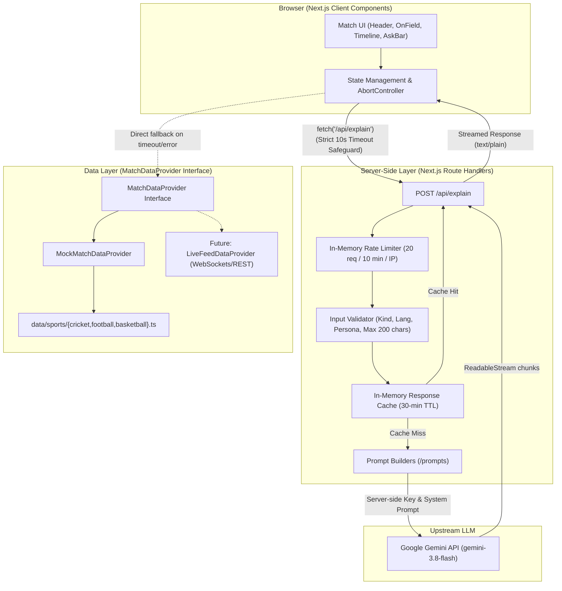

# Match Buddy 🏏⚽🏀

**Match Buddy** is a lightning-fast, production-hardened AI live match companion built for casual and passionate sports fans watching live broadcasts with friends or family.

---

## 1. The Fan Problem & Target Persona

### The Persona
- **Who:** A casual or social fan watching an intense live sports match (India vs Australia in Cricket, El Clásico in Football, or Lakers vs Warriors in the NBA) alongside passionate friends.
- **The Pain Point:** Whenever an unfamiliar player steps onto the pitch (e.g., *"Wait, who is Hardik Pandya again? Why does he have a strike mark?"*) or a technical umpire ruling occurs (e.g., *"What is DLS method?"*, *"Why was that not offside?"*), they feel hesitant or awkward interrupting the group to ask. Searching Google or Wikipedia returns dense, dry encyclopedic articles that kill match momentum.
- **The Solution:** Match Buddy provides a single-tap broadcast companion:
  - **Tap any player card** for a concise, 2-line intro explaining their role, form, and tactical significance right now.
  - **Tap any timeline event** or type a query for an instant 2-line explanation in plain **English** or conversational **Hinglish**.
  - **Live Win Probability Meter** calculated deterministically using situation metrics (required run rate vs resources), not hallucinated by an LLM.

---

## 2. What the App Does

- **Multi-Sport Coverage:** Dedicated tabs for **Cricket** (IND vs AUS), **Football** (Real Madrid vs Barcelona), and **Basketball** (Lakers vs Warriors).
- **Dual-Language Modes:** Instant toggle between English and conversational Hinglish (`EN` / `हिंग`).
- **3 Fan Personas:** Casual Fan (friendly & accessible), Tactical Analyst (data & matchups), and Desi Buddy (cricket banter & masala).
- **Deterministic Win Probability:** A pure mathematical calculation (RRR vs resources in cricket, score difference vs time in football/basketball).
- **Graceful Offline Fallbacks:** Zero blank screens. If offline, rate-limited, timed out, or unconfigured, the app falls back to curated verified facts with a clear note.
- **Audio Read-Aloud:** One-tap text-to-speech commentary with native pronunciation and speech queue safeguards.
- **Desktop & Mobile Responsive:** Centered mobile container on phones; elegant two-column layout on widescreen displays (`≥ 1024px`).

---

## 3. Architecture



---

## 4. Setup and Run Locally

### Prerequisites
- Node.js `20.x` or later
- npm `10.x` or later

### Installation Steps

1. **Clone the repository:**
   ```bash
   git clone <repo-url>
   cd "Match Buddy"
   ```

2. **Install dependencies:**
   ```bash
   npm install
   ```

3. **Configure Environment Variables:**
   Copy `.env.example` to `.env.local`:
   ```bash
   cp .env.example .env.local
   ```
   Add your Google Gemini API key:
   ```env
   GEMINI_API_KEY=your_gemini_api_key_here
   GEMINI_MODEL=gemini-3.8-flash
   ```
   *(Note: The app will run smoothly with curated fallbacks even if no API key is supplied!)*

4. **Run the Development Server:**
   ```bash
   npm run dev
   ```
   Open [http://localhost:3000](http://localhost:3000) in your browser.

5. **Run Unit Tests:**
   ```bash
   npm test
   ```

6. **Create Production Build:**
   ```bash
   npm run build
   ```

---

## 5. Environment Variables

| Variable | Description | Default | Required? |
| :--- | :--- | :--- | :--- |
| `GEMINI_API_KEY` | Google Gemini API key used by the server route | *(empty)* | Optional (fallbacks engaged if missing) |
| `GEMINI_MODEL` | Gemini generative model version | `gemini-3.8-flash` | Optional |

> **Security Guardrail:** All Gemini API keys are read strictly on the server (`process.env.GEMINI_API_KEY`). The browser client never touches, receives, or stores API keys. `.env*` files are strictly gitignored.

---

## 6. How to Add a Team, Player, or Event

Because the data layer is decoupled via the `SportMatchConfig` schema and `MatchDataProvider` interface, **adding or editing sport data requires ZERO component changes**:

1. Open the sport file in `data/sports/` (e.g., `data/sports/cricket.ts` or create a new sport module):
2. Add the player to the `players` array:
   ```ts
   {
     id: "jasprit-bumrah",
     name: "Jasprit Bumrah",
     role: "Bowler",
     onField: "3.4-1-14-2",
     country: "India",
     formats: ["Test", "ODI", "T20I"],
     avatarInitials: "JB",
     keyFacts: [
       "// TODO verify",
       "Premier yorker specialist with unique hyperextended bowling action",
       "Player of the Tournament at the 2024 ICC Men's T20 World Cup"
     ],
     fallbackIntro: {
       en: "Jasprit Bumrah is India's strike pace ace who suffocates run scoring at the death.",
       hinglish: "Jasprit Bumrah India ke world-class pacer hain jinki deadly yorkers game badal deti hain."
     }
   }
   ```
3. Add any event to the `events` array or rule to `rulesDictionary`.
4. The UI automatically displays the player card, initializes the strike badge, and hooks up the AI and offline fallbacks without changing any TSX code.

---

## 7. Key Design Decisions

1. **Curated Facts + AI Context:**
   - LLMs can easily hallucinate career statistics or birthplace facts. Match Buddy feeds verified facts from the curated dataset into the Gemini prompt so the AI only explains tactical significance in context.
2. **Deterministic Win Probability:**
   - Match win probabilities are computed with pure mathematical functions (`lib/winProbability.ts`) evaluating required run rate, balls left, and wickets in hand. This ensures numbers stay mathematically consistent as the score ticks.
3. **Multi-Tier Fallbacks & In-Memory Caching:**
   - If an API request fails, hits rate limits (429), or exceeds the 10-second timeout, the UI instantly displays the pre-calculated fallback text with a transparent note: `"Showing a saved explanation"`.
   - Repeated clicks or reviewer traffic hit a 30-minute in-memory LRU cache (`lib/cache.ts`), saving quota and returning instant responses.
4. **Server-Side Security:**
   - The browser client never stores API keys in `localStorage` or passes them over headers. All calls route through `/api/explain` with IP rate limiting and 200-character input sanitization.
5. **Aesthetic & Accessibility Standards:**
   - Rich dark theme with glassmorphism cards and neon gradients.
   - Strictly conforms to WCAG AA contrast (≥ 4.5:1), touch targets ≥ 44px, and minimum text size of 12px.
   - Dynamic `lang="hi-Latn"` attribute when Hinglish commentary is displayed.
   - Respects `prefers-reduced-motion`.

---

## 8. Honest Limitations

- **Simulated Match Feeds:** This build uses curated mock match situations and simulated play-by-play timelines rather than a paid real-time WebSocket broadcast provider (e.g., Sportradar / Opta).
- **AI Can Make Mistakes:** While player facts are grounded in verified datasets, generative AI can occasionally misinterpret nuances.
- **In-Memory Cache & Rate Limiting:** The rate limiter (20 requests per 10 minutes) and 30-minute response cache run in server process memory and will reset upon container restart or deployment on serverless environments without Redis.
